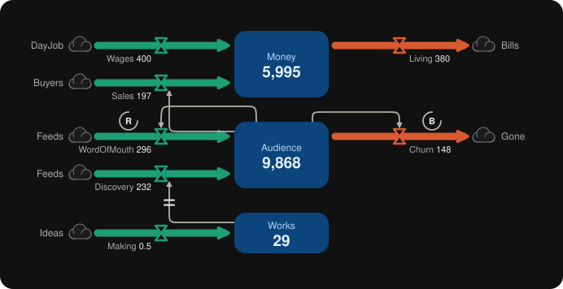

# Gray Mirror

**Make the unseen seen.**




https://github.com/user-attachments/assets/c6390147-796e-46a8-bd75-7d33f1a7e65d


Gray Mirror is a skill for Claude that turns your situation into a living stock-and-flow map and runs it.

Talk to Claude about your money, your energy, your habits, your team, your game economy. Anything that piles up and drains. Claude draws the map. You guess what happens. You hit Run and watch it play out week by week. Then you change one thing and run it again.

Two files. No install wizard. No modeling degree.

## Why I made this

I'm an artist and a builder, not a computer scientist.

For about two years I was trying to make a tool that would let me see my own life as a system. People, money, visions, tools, all connected, all affecting each other. I kept circling it because I didn't have the vocabulary yet. When I finally found it, in Donella Meadows and the people who came before her, I realized I'd already been building the thing.

I was tired of being clever and not intelligent. Clever is tweaking the numbers. Intelligent is seeing the structure that makes the numbers. Most of us never get shown that structure. We just feel it.

The tools that exist for this are powerful, but they're built for specialists. I wanted something you could open in a conversation and get in a minute. I want to be the kind of artist a computer scientist hangs out with, and I want everyone else to get to hang out too.

The world would be a better place if more of us thought in systems. My pain to yours. This is for humans.

Some call this systems thinking. Some call it something older.

Law Watusi

## How it works

1. **Name it.** Tell Claude what's going on. It finds the stocks (what piles up), the flows (what fills and drains them), and the loops (what feeds back).
2. **Predict it.** Before you run anything, guess what the line will do. The learning lives in the gap between your guess and what happens.
3. **Run it.** Watch every stock move, week by week.
4. **Change one thing.** "What if I cut this in half?" One line changes, and you run it again.

## Get it

### In the Claude app (web, desktop, mobile)
1. Download the `gray-mirror` folder from this repo and zip it.
2. In Claude, go to **Settings > Capabilities** and make sure **Code execution and file creation** is on.
3. Go to **Customize > Skills**, click **+**, then **+ Create skill**, then **Upload a skill**, and upload the zip.
4. Start a chat and say something like *"Map my money for the next year."*

Full steps from Anthropic: [Use skills in Claude](https://support.claude.com/en/articles/12512180-use-skills-in-claude).

### In Claude Code
Put the `gray-mirror` folder in `~/.claude/skills/`. Skills you've added in the Claude app also sync to Claude Code when you sign in with the same account.

### Without Claude
Open `gray-mirror/renderer.html` in any browser, paste a model into the box, and hit Run. The `examples` folder has a couple to start with.

## Things to say to Claude
- "Map my money for the next year."
- "Why do I keep burning out? Draw it."
- "Model the economy of my game."
- "What happens to my audience if I post twice as often?"

## The notation

Plain text that both you and Claude can read and write.

```
tick = week
stock  Money = 1200
cloud  DayJob
cloud  Bills
flow   Wages:  DayJob -> Money = 400
flow   Living: Money -> Bills = 10% of Money
link   Money ~> Living
loop   B  Money, Living
```

| Word | Means |
|---|---|
| `tick = week` | The time step: day, week, month. |
| `stock Name = n` | Something that piles up and can be measured right now. |
| `cloud Name` | Where a flow comes from, or goes to, outside the map. |
| `flow Name: A -> B = n` | A rate per tick. Use a number, or `p% of Stock`. The arrow sets the direction. |
| `link Stock ~> Flow` | The stock's level changes that flow's speed. Delayed: `~\|\|>` |
| `loop R` / `loop B` | Reinforcing (snowballs) or balancing (seeks a level). |

## Your first lesson

Open `examples/bathtub.txt`. Water flows in at 3 per tick and drains at 10% of whatever is in the tub. Where does it settle?

Find the level where the drain takes exactly 3: 3 = 0.1 × water, so the water settles at **30**. It gets there no matter where it starts. Double the faucet and it settles at 60. Halve the drain and it also settles at 60.

That's the whole game: **the level is set by the structure, not by how hard you push.**

## Credits

Gray Mirror (the notation, the renderer, and the skill) by **Law Watusi**, 2026.

Built on system dynamics, founded by **Jay Forrester** at MIT in the 1950s, and the stock-and-flow language as taught by **Donella Meadows** in *Thinking in Systems: A Primer* (2008).

Good neighbors worth knowing:
- [Text2Sim MCP Server](https://github.com/IamCatoBot/text2sim-MCP-server): runs system dynamics and discrete-event simulations inside Claude.
- [systems-thinking-skills](https://github.com/bayramannakov/systems-thinking-skills): Claude skills that coach you through systems diagrams, archetypes, and leverage points.
- Machinations (Joris Dormans), Loopy (Nicky Case), Insight Maker, Stella, Vensim.

## Find me

- Site: [watusi.cloud](https://watusi.cloud)
- GitHub: [@watusiii](https://github.com/watusiii)

If Gray Mirror shows you something, tell me what you saw.

## License

MIT. 
